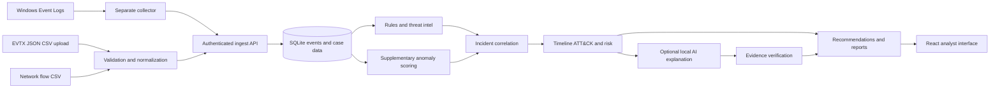

# Architecture

## System overview

The application is a local web tool with a React/Vite interface and a FastAPI service backed by SQLite. Windows Event Log data arrives either through the separate Python/PowerShell collector or through `.evtx`, `.json`, and `.csv` uploads. Network flow CSVs are also accepted. The backend normalizes records into a shared event schema, stores them, evaluates rules and threat-intelligence indicators, correlates detections into incidents, and presents evidence, timeline, ATT&CK context, risk, and recommendations. An optional local Ollama model can explain the structured evidence; deterministic template mode is the default. Analysts approve or reject recommendations, but those response actions are simulated only.

## Backend components

- `backend/app/main.py` creates the FastAPI app, initializes SQLite, runs migrations, applies security headers/CORS, and enables interactive API docs only for `APP_ENV=development`.
- `backend/app/auth/` implements Argon2 password verification, short-lived JWTs, role authorization, step-up checks, MFA, and server-side revocation. Every route is covered by `ROUTE_PERMISSIONS` in `permissions.py` (deny by default).
- `backend/app/collector/` parses and normalizes Windows events, EVTX, JSON/CSV, and network flow records. Uploads are size/type/content checked, staged with random names, encrypted, parsed, and removed.
- `backend/app/detection/` contains built-in YAML-style and network rules, Sigma import support, custom rules, ATT&CK references, and threat-intelligence matching.
- `backend/app/analysis/` builds incidents, timelines, risk, graphs, investigations, and report data.
- `backend/app/ai/` handles optional local model calls, deterministic fallback behavior, structured output validation, and evidence checks. Log content is untrusted input; AI output does not override rule-derived risk or execute actions.
- `backend/app/audit.py` appends SHA-256-linked audit records and maintains an audit-chain head. Admins can check integrity through `GET /api/audit/verify`.
- `backend/app/export_quota.py` enforces the configurable rolling per-user export quota and writes an audit alert when blocked.

## Data and trust boundaries

1. **Collector to API:** collector ingestion uses a dedicated `X-Collector-Key`; the web server itself runs without administrator privileges.
2. **Uploads to parser:** uploaded bytes and filenames are untrusted. The server applies allowlists, size limits, content checks, random server filenames, schema validation, and duplicate filtering. The EVTX parser temporarily needs a plaintext file; it is removed after parsing.
3. **Events to detection and AI:** detections are rule-driven. Only structured incident context is supplied to the optional AI; claims are checked against known evidence IDs. Human approval remains required for response recommendations.
4. **User to API:** server-side RBAC protects routes, viewer responses redact command content, MFA/step-up protect sensitive account operations, and revoked access tokens are rejected on every protected request.
5. **Sensitive values at rest:** passwords are Argon2 hashes, MFA secrets use Fernet with the external `DATA_ENCRYPTION_KEY`, uploads are encrypted while staged, and generated exports are not persisted. The encryption key must remain stable and private.

## Storage

SQLite stores normalized events, detections, incidents, users, settings, recommendations, and audit entries. WAL mode supports concurrent readers with the application's single-writer workload. New schema is created and additive legacy columns are migrated at startup. Existing plaintext MFA values and leftover UUID-named uploaded files are encrypted at startup when `DATA_ENCRYPTION_KEY` is configured.

The audit chain detects partial modification, reordering, and tail deletion as long as the chain-head row remains intact. Because both data and head are in the same SQLite file and hashes are unkeyed, this is tamper evidence against accidental or limited edits—not a substitute for exporting signed audit records to a separately controlled system.

## Frontend

`frontend/src/` contains React pages for login, dashboards, logs, detections, ATT&CK, incidents, devices, network data, anomalies, settings, audit, and reports. The frontend hides unavailable actions for usability, but backend authorization remains authoritative. Auth tokens live in memory and logout calls the API to revoke the current token before clearing the client session.

## Runtime modes

- `APP_ENV=development`: local FastAPI docs are enabled.
- Other `APP_ENV` values: `/docs`, `/redoc`, and `/openapi.json` are not registered.
- `LLM_PROVIDER=template`: deterministic offline explanations, suitable for tests and demos.
- `LLM_PROVIDER=ollama`: optional local inference using `LLM_MODEL` and `OLLAMA_BASE_URL`.
- Live Windows collection is a separate elevated process. Uploads and synthetic data are available for environments without that collector.
